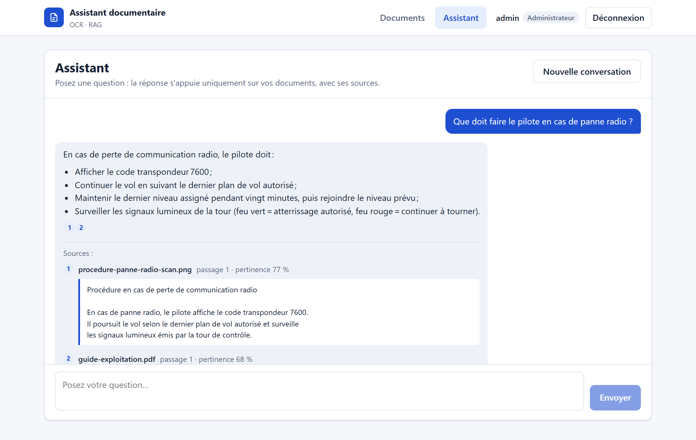
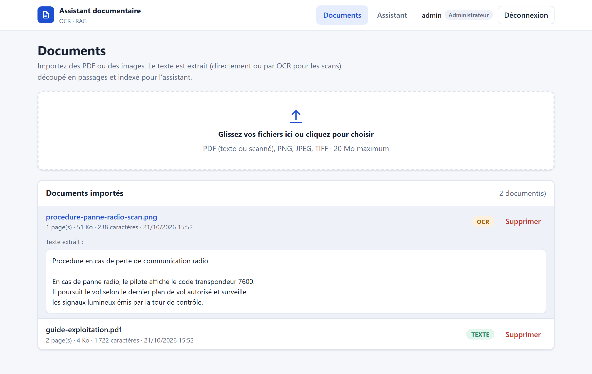
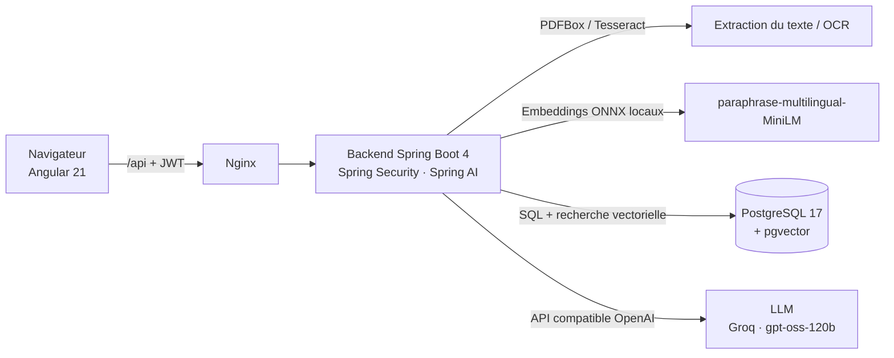

# Assistant documentaire intelligent (OCR + RAG)

[](https://github.com/PaM02/assistant-doc-ia/actions/workflows/ci.yml)

Application web qui permet d'importer des documents (PDF numériques, PDF scannés, images),
d'en extraire le texte — par **OCR** si nécessaire — puis de les interroger en langage naturel
grâce à un **chatbot RAG** (*Retrieval-Augmented Generation*) qui cite ses sources.

> Projet personnel de démonstration (octobre 2026), réalisé avec des documents fictifs ou publics.

| Assistant : réponse avec sources citées | Documents : texte reconnu par OCR |
|---|---|
|  |  |

## Fonctionnalités

- **Import de documents** par glisser-déposer : PDF texte, PDF scanné, PNG, JPEG, TIFF (20 Mo max).
- **Extraction du texte** : lecture directe du PDF (Apache PDFBox) ou **OCR** Tesseract (français + anglais)
  lorsque le PDF ne contient qu'une image.
- **Recherche sémantique** : le texte est découpé en passages, transformés en *embeddings* par un modèle
  multilingue exécuté **en local**, et stockés dans PostgreSQL avec **pgvector**.
- **Chatbot RAG** : les passages les plus pertinents sont transmis à un grand modèle de langage, qui répond
  uniquement à partir de ces extraits et **cite ses sources** ; sans information pertinente, il le dit au lieu d'inventer.
- **Sécurité** : authentification **JWT**, rôles `ADMIN` (import, suppression) et `USER` (consultation, assistant).

## Architecture



**Parcours d'une question :**
1. *Retrieval* — la question est transformée en vecteur ; pgvector renvoie les passages les plus proches
   (distance cosinus, index HNSW).
2. *Augmented* — ces passages, numérotés, sont ajoutés au message envoyé au modèle.
3. *Generation* — le modèle rédige la réponse en citant les passages utilisés ([1], [2]…).

## Stack technique

| Domaine | Technologies |
|---|---|
| Backend | Java 21, Spring Boot 4.1, Spring Security (OAuth2 Resource Server / JWT), Spring Data JPA, Spring AI 2.0 |
| IA | Tesseract 5 (Tess4J), modèle d'embedding ONNX local, LLM via API compatible OpenAI (Groq) |
| Données | PostgreSQL 17, pgvector (HNSW), migrations Flyway |
| Frontend | Angular 21 (composants standalone, signals), SCSS, Vitest |
| DevOps | Docker (images multi-étapes, utilisateur non root), Docker Compose, GitHub Actions, GHCR |

## Démarrage rapide (Docker)

Prérequis : Docker.

1. Créer le fichier `backend/.env` (jamais versionné) :
   ```properties
   GROQ_API_KEY=gsk_...            # clé gratuite sur console.groq.com
   JWT_SECRET=une-chaine-aleatoire-d-au-moins-32-caracteres
   ADMIN_PASSWORD=...              # mot de passe du compte « admin »
   USER_PASSWORD=...               # mot de passe du compte « lecteur »
   ```
2. Lancer l'application :
   ```bash
   docker compose up -d --build --wait
   ```
3. Ouvrir http://localhost:8090 et se connecter avec `admin` ou `lecteur`.
4. Importer par exemple les fichiers du dossier [`samples/`](samples), puis poser une question à l'assistant.

## Développement local

Prérequis : JDK 21+ (voir la note Windows ci-dessous), Node.js 22+, Docker.

```bash
# Backend (démarre aussi PostgreSQL via backend/compose.yaml, port 5433)
cd backend
./mvnw spring-boot:run

# Frontend (http://localhost:4300, appels /api redirigés vers le backend)
cd frontend
npm install
npm start
```

Fichiers de langue OCR pour le développement : `backend/scripts/download-tessdata.ps1`.

> **Note Windows** : les DLL Tesseract embarquées par Tess4J exigent un runtime Visual C++ ≥ 14.40.
> Certains JDK (ex. 21.0.4) embarquent un `msvcp140.dll` plus ancien, ce qui fait planter l'OCR
> (`Invalid memory access`) : utiliser un JDK récent. Le problème n'existe pas dans Docker.

## API

| Méthode | Chemin | Rôle | Description |
|---|---|---|---|
| `POST` | `/api/auth/login` | public | Connexion, renvoie un jeton JWT |
| `GET` | `/api/auth/me` | connecté | Utilisateur courant |
| `POST` | `/api/documents` | ADMIN | Import d'un fichier (multipart) : extraction + indexation |
| `GET` | `/api/documents` | connecté | Liste des documents |
| `GET` | `/api/documents/{id}` | connecté | Détail et texte extrait |
| `DELETE` | `/api/documents/{id}` | ADMIN | Suppression (passages supprimés en cascade) |
| `GET` | `/api/search?q=…&topK=5` | connecté | Recherche sémantique |
| `POST` | `/api/chat` | connecté | Question → réponse + sources |

Les erreurs sont renvoyées au format standard `ProblemDetail` (RFC 9457).

## Tests et intégration continue

- **Backend** : tests unitaires (découpage, citations) et tests MockMvc des règles de sécurité
  (401, 403, jeton émis puis validé, jeton falsifié), test d'intégration du contexte Spring avec PostgreSQL.
- **Frontend** : tests Vitest (mise en forme sécurisée des réponses du modèle, navigation).
- **Pipeline GitHub Actions** (`.github/workflows/ci.yml`) à chaque push :
  1. build et tests du backend (PostgreSQL/pgvector en service) ;
  2. tests et build du frontend ;
  3. construction des images Docker, démarrage de l'application complète et **test de fumée**
     ([`scripts/smoke_test.py`](scripts/smoke_test.py) : connexion → OCR → recherche → chatbot) ;
  4. sur `main`, publication des images sur GitHub Container Registry.

## Choix techniques

- **Embeddings en local** (ONNX) : gratuits, sans envoi des documents à un service tiers pour l'indexation.
- **Fournisseur de LLM interchangeable** : API compatible OpenAI ; changer `AI_BASE_URL` / `AI_CHAT_MODEL`
  suffit pour passer à un autre fournisseur, sans modifier le code.
- **Limitation des hallucinations** : consigne stricte au modèle, seuil de pertinence (pas d'appel au modèle
  sans passage pertinent), sources réellement citées renvoyées à l'utilisateur.
- **Schéma versionné avec Flyway** (`ddl-auto=validate`) : même schéma en développement, en CI et en production.
- **Sécurité** : API stateless, mots de passe BCrypt, secrets hors du code (`.env`, secrets GitHub),
  conteneurs exécutés sans droits root, réponses du modèle échappées avant affichage.
